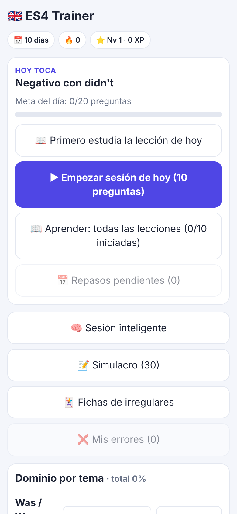

# Prototipo para estudiar inglés

[](LICENSE)


**App gratuita y de código abierto para aprender la base del inglés y el inglés técnico que necesitas para estudiar programación y ciberseguridad.** Pensada para estudiantes hispanohablantes de informática. Es un solo archivo HTML: no necesita instalación, cuenta, servidor ni internet, así que funciona incluso en celulares antiguos o con mala conexión.

> *Free, open source, offline English trainer for Spanish-speaking IT students: core English grammar plus the technical English used in programming docs, error messages and cybersecurity. Single HTML file, zero dependencies.*

▶️ **Probarla ahora:** descarga o clona el repositorio y abre `index.html` en Chrome o Edge (no necesita instalación, cuenta ni internet). La demo en línea con GitHub Pages está en preparación: el workflow `.github/workflows/pages.yml` ya está configurado y se activará cuando el despliegue quede habilitado.

<p align="center"></p>

### Por qué existe
La mayoría de la documentación, los cursos, las certificaciones y las respuestas en foros de programación y ciberseguridad están **en inglés**. Para muchos estudiantes de Latinoamérica, el idioma es la primera barrera para aprender tecnología, antes que el código.

Esta app ataca esa barrera en dos partes:

1. **La base del inglés** (gramática y vocabulario A1), alineada con el curso obligatorio *Inglés Inicial* de INACAP. Es el punto de partida.
2. **Inglés para informática:** vocabulario de programación, cómo leer mensajes de error y documentación, y vocabulario esencial de ciberseguridad, conectado con la gramática (imperativo de la documentación, pasado simple de los informes de incidentes).

Todo con explicaciones en español, repetición espaciada, simulacros con nota en escala chilena, práctica de listening y speaking, y sin costo.

### Estado del proyecto y evidencia

Proyecto nuevo y pequeño (1 mantenedor, sin estrellas ni descargas medibles todavía). Lo que existe hoy en este repositorio:

| Qué | Detalle |
|---|---|
| Inglés para informática | 3 lecciones (programación, mensajes de error y documentación con códigos HTTP, ciberseguridad) y 50 preguntas originales: 16 de programación, 16 de errores y documentación, 18 de ciberseguridad |
| Banco de preguntas | 251 preguntas en total, con repetición espaciada y explicaciones en español |
| Sin barreras de acceso | Un solo `index.html`, 0 dependencias, sin cuenta ni servidor; funciona sin internet y se instala como PWA (`manifest.webmanifest`, íconos y `sw.js`) |
| Seguimiento | Gráfico de progreso de 14 días y gráfico de notas de simulacros |
| Proyecto abierto | Licencia MIT, [CONTRIBUTING.md](CONTRIBUTING.md) y [ROADMAP.md](ROADMAP.md) |

Captura de la app: `docs/screenshot.png` (arriba). Cada afirmación de esta tabla se puede comprobar abriendo `index.html`.

### 📲 Instalar en el celular
Cuando la demo en línea esté activa, ábrela en el celular → menú del navegador → **"Agregar a pantalla de inicio"** (Chrome/Android) o **Compartir → "Agregar a inicio"** (Safari/iPhone). Queda como una app más y **funciona sin internet**.

**Aportes bienvenidos:** lee [CONTRIBUTING.md](CONTRIBUTING.md) y la [hoja de ruta](ROADMAP.md).

---

**Origen del proyecto:** app web de un solo archivo (`index.html`) para estudiar inglés nivel A1 y sacar nota 7 en la **ES4** del curso *Inglés Inicial* (INACAP, FGES01). No necesita internet, ni instalación, ni servidor: se abre con doble clic.

## Cómo usarla

1. Descarga o clona el repo.
2. Abre `index.html` en Chrome o Edge (también funciona en el celular).
3. Tu progreso se guarda solo en el navegador (`localStorage`, clave `ing_es4_trainer_v1`).

## Contexto del curso (para quien continúe el proyecto)

- **Curso:** Inglés Inicial, nivel A1 (MCER), modalidad presencial, INACAP Temuco.
- **Libro:** Oxford *Wide Angle* Level 1A y 1B (Student Book, Workbook y práctica online).
- **Evaluaciones:**

| Unidad | Evaluación | Tipo | % | Contenido |
|---|---|---|---|---|
| 1 | ES1 | Prueba escrita / online | 15% | Present simple, información personal |
| 1 | ES2 | Presentación oral | 25% | Present simple, información personal |
| 2 | ES3 | Role play | 30% | Present simple y continuous, likes y dislikes |
| 3 | **ES4** | **Prueba mixta (escrita / online)** | **30%** | **Simple past, conectores y secuencia** |

- **ES4 = Unidad 3 "Past Times" = Wide Angle 1B, unidades 7 y 8.** Fecha objetivo: **4 de diciembre de 2026**.
- Temas por clase según el cronograma oficial: clima, *was/were* (afirmativo, negativo, preguntas), fechas y expresiones de tiempo, conectores **and / but / because**, pasado simple regular e irregular (afirmativo, negativo y preguntas con *did*).
- Después de la ES4 hay un examen final escrito de todas las unidades.
- Escala de notas chilena: 60% de exigencia = 4.0, 100% = 7.0.

## Inglés para informática (v0.4)

- **3 lecciones nuevas:** 💻 palabras clave para programar · 🐞 leer mensajes de error y documentación (incluye códigos HTTP) · 🛡️ vocabulario esencial de ciberseguridad.
- **50 preguntas originales** (16 de programación, 16 de errores y documentación, 18 de ciberseguridad) de alternativas, escritura y ordenar oraciones.
- Cada lección conecta el vocabulario con la gramática: el **imperativo** de las instrucciones («Run the following command») y el **pasado simple** de los commits y los informes de incidentes («The attacker stole the passwords»).
- Botón **«Practicar inglés técnico»** en el inicio. Estos temas **no se mezclan con el simulacro de la ES4**.

## Qué hace la app (v0.3)

- **📖 Aprender (módulo de estudio):** 10 lecciones en español basadas en el Student Book 1B (unidades 7 y 8) y en el cronograma: was/were, expresiones de tiempo y clima, fechas y años, conectores y secuencia, regulares (-ed y pronunciación), irregulares (todos los del libro con 🔊), negativo, preguntas con did, vocabulario y frases del libro (ropa, disculpas, reacciones) y un resumen con estrategia de prueba. Cada lección tiene ejemplos con audio y una prueba rápida de 3 preguntas, y se marca como "entendida".
- **Hoy toca:** sesión de 10 preguntas según el plan por fechas (`PLAN` en el código), con acceso a la lección del día.
- **Sesión inteligente:** repetición espaciada. Las preguntas falladas aparecen más seguido (cajas 0 a 4, tipo Leitner).
- **Práctica por tema:** was/were, regulares, irregulares, negativo, preguntas, conectores, tiempo y clima, lectura, dictado.
- **Simulacro de 30 preguntas** con cronómetro de 30 minutos y nota estimada en escala chilena.
- **Fichas de verbos irregulares** (49 verbos, con traducción).
- **Listening por dictado** con la voz del navegador (Web Speech API, inglés US, velocidad normal y lenta).
- **Mis errores:** repite solo lo que fallaste.
- **Gamificación:** XP, niveles, racha diaria, meta de 20 preguntas por día y cuenta regresiva al examen.
- **Importar preguntas de ChatGPT:** pega un JSON y las preguntas quedan guardadas en tu navegador.

Banco actual: **251 preguntas**: 58 irregulares, 40 regulares, 25 tiempo/fechas/clima, 19 was/were, 16 preguntas con did, 27 listening (12 comprensión auditiva y 15 dictados), 13 negativo, 13 vocabulario, 12 conectores, 16 lectura y 12 escritura guiada. Las fichas contienen 53 verbos irregulares.

Contenido tomado del Student Book Wide Angle 1B (unidades 7 y 8, pp. 4–26, Review pp. 75–76 y Grammar focus pp. 81–82). Las oraciones de práctica son originales, no copias del libro.

## Módulos mejorados (rama de desarrollo v0.3)

La app sigue siendo un solo archivo HTML, sin servicios propios ni librerías. Se conserva el progreso de versiones previas mediante la misma clave local.

- **Aprender:** 10 lecciones con tres comprobaciones cada una. La primera finalización exige responder las preguntas; la comprobación posterior se habilita otro día. Solo se marca recuerdo confirmado al acertar las tres al primer intento. Si no se consigue, la siguiente comprobación se realiza otro día.
- **Práctica a medida:** nuevo menú «No sé qué practicar», ejercicios nuevos, dificultades detectadas y sesiones breves. La sesión diaria intercala hasta cuatro repasos pendientes con el tema del plan. La sesión inteligente combina repasos, puntos débiles y preguntas variadas. En prácticas normales, el botón «No entiendo» ofrece apoyo; usarlo no cuenta como recuerdo independiente.
- **Reto sin pistas:** preguntas para escribir y ordenar oraciones sin botón de ayuda, útil para identificar cuándo una respuesta se recuerda y cuándo solo se reconoce.
- **Repasos:** las fichas reveladas son autoevaluaciones, no aumentan el dominio confirmado. Cada pregunta tiene una próxima fecha de revisión. Los aciertos sin ayuda en tres días diferentes son necesarios para aparecer como dominio confirmado; repetirla varias veces el mismo día no multiplica ese progreso. Se incluye un reto de 10 preguntas para recordar sin pistas.
- **Listening:** 12 actividades adicionales de comprensión (audio y alternativas) y 15 dictados originales. Se utilizan voces disponibles en el navegador.
- **Reading:** 9 ejercicios nuevos de comprensión lectora contextualizada.
- **Writing:** 12 ejercicios nuevos de traducción y ordenación de oraciones.
- **Speaking:** 12 frases con audio, repetición y reconocimiento opcional del navegador. No es una evaluación profesional de pronunciación.
- **Simulacros:** conserva el formato de 30 preguntas, cuenta regresiva y nota; registra resultados recientes.
- **Avance:** historial de actividad diaria, recordatorios de repaso y progreso por tema; exportación e importación de copias JSON para mover el progreso entre dispositivos.
- **Móvil:** estilos adaptables a pantallas estrechas, áreas táctiles de al menos 44 px, tablas con desplazamiento horizontal, controles de texto y soporte para márgenes de pantalla segura.

### Advertencias y alcance

- **Compatibilidad sin internet:** la interfaz y las preguntas no necesitan internet; algunas funciones de voz o reconocimiento sí pueden depender de servicios del navegador, permisos de micrófono o conexión. Su disponibilidad varía entre dispositivos, especialmente cuando la aplicación se abre mediante `file://`.
- **Sin sincronización automática:** cada navegador y dispositivo mantiene su propio progreso. Puedes exportar un respaldo JSON e importarlo manualmente en otro dispositivo; importar reemplaza el progreso de ese navegador tras confirmación.
- **No confundir progreso con nivel de inglés:** XP, cantidad de preguntas o lecciones completadas no son equivalentes a competencia comunicativa. El dominio confirmado solo expresa rendimiento en los ejercicios concretos de la app.
- **Asignaturas:** esta versión continúa centrada en Inglés Inicial, especialmente ES4. Inglés Habilitante e Inglés Intermedio requieren sus programas oficiales antes de incorporar contenido.
- **Inspiración pedagógica:** se adoptan ideas generales de práctica breve, repaso, personalización y entrenamiento multisensorial. No se copia diseño, arte, marca ni contenido de Duolingo.

## Estructura del código

Todo está en `index.html`: CSS, HTML y JavaScript sin librerías.

| Parte del script | Qué hace |
|---|---|
| `TOPICS`, `PLAN` | Temas y plan de estudio por fechas |
| `HAND`, `IRR`, `REG` | Banco de preguntas escritas a mano y listas de verbos |
| `LESSONS`, `renderBlock()`, `learnHome()`, `openLesson()` | Módulo Aprender: lecciones hechas con bloques (`P`, `R`, `TIP`, `W`, `X`, `TB`, `CK`) |
| `buildBank()` | Junta todo, más las preguntas importadas, y les asigna un `id` |
| `pick()`, `weight()` | Selección ponderada por dominio (repetición espaciada) |
| `record()` | Guarda aciertos, errores, XP y racha |
| `home()`, `renderQ()`, `finish()`, `cards()`, `importScreen()` | Pantallas |

## Formato de las preguntas (JSON)

Cuatro tipos. Estos son los mismos que se pueden importar desde ChatGPT.

```json
{"topic":"neg","type":"mcq","q":"I ___ go to school yesterday.","options":["didn't","don't","wasn't"],"answer":0,"explain":"didn't + verbo base"}
{"topic":"q","type":"type","q":"Did they like the food? — No, they ___.","answers":["didn't"],"explain":"respuesta corta"}
{"topic":"q","type":"order","answer":"Where did he go last night?","explain":"Wh- + did + sujeto + verbo base"}
{"topic":"dict","type":"dict","answer":"We didn't watch the movie."}
```

- `topic`: `be`, `reg`, `irr`, `neg`, `q`, `conn`, `time`, `vocab`, `read`, `dict`.
- En `mcq`, `answer` es el índice (desde 0) de la opción correcta.
- En `type`, `answers` lista todas las respuestas aceptadas. Se ignoran mayúsculas, puntuación y apóstrofes curvos.

## Ideas para seguir (backlog)

- [ ] Agregar los temas de ES1 a ES3 (present simple y continuous, likes y dislikes) para el examen final.
- [ ] Más preguntas de **secuencia** (first, then, after that, finally) si el profesor las evalúa.
- [ ] Modo "examen final" mezclando todas las unidades.
- [x] Gráfico de progreso por día.
- [x] Instalar como PWA para usarla como app en el celular.
- [x] Exportar e importar el progreso (copia de seguridad).
- [x] Publicar con GitHub Pages (configurado; ver ROADMAP).
- [ ] Modo oral (hablar y escribir quedaron fuera de esta primera versión a petición del estudiante).

## Prompt para continuar el proyecto con ChatGPT

Copia esto en ChatGPT y adjunta `index.html`:

> Este es un prototipo de app web de un solo archivo para estudiar inglés A1 (Wide Angle 1B, unidades 7 y 8: pasado simple, was/were, conectores and/but/because) para una prueba de INACAP el 4 de diciembre de 2026. Lee el README para ver el contexto. Quiero que mejores la app sin romper lo que ya funciona, manteniéndola en un solo archivo HTML sin librerías externas. Devuélveme siempre el archivo completo. Primero te pido: [escribe aquí qué quieres cambiar].
